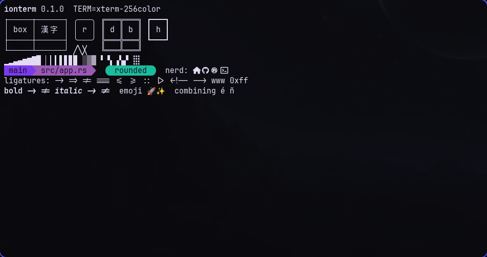

# ionterm

A fast, GPU-rendered terminal for the Ionix desktop. It picks up your wallpaper colours, draws its box lines without gaps, and has room for kitty-style tricks.

The Ionix theme, mid-demo. Yes, the box lines actually touch.

## Key Features

- **GPU rendering**: everything is drawn with wgpu (Vulkan on Linux, DX12 on Windows), so scrolling through a huge log doesn't heat your lap.
- **Ionix theming**: plugs into the Ionix styler like kitty and ioexplorer do, wallpaper-adaptive colours included. Switch themes and the open terminal recolours itself.
- **Live config**: edit `ionterm.toml` and the change shows up while you're still in the editor.
- **Ligatures and Nerd Fonts**: `->`, `!=` and `===` join up, and icons render, including Powerline segments.
- **Pixel-perfect box drawing**: lines, blocks, rounded corners and Powerline arrows are drawn by ionterm itself, so TUIs look sharp in any font.
- **Modern protocols**: kitty keyboard protocol, synchronized output, styled and coloured underlines, truecolor, bracketed paste, focus events, OSC 52 clipboard.
- **Mouse that behaves**: click-drag, double-click word and triple-click line selection, primary selection on middle click, and mouse reporting for TUIs (hold shift to select anyway).
- **Clickable links**: links that programs print and plain URLs get underlined on hover; ctrl+click opens them.
- **Reflow**: resize the window and long lines re-wrap instead of getting chopped, which matters when Hyprland keeps retiling.
- **SSH-friendly**: `TERM` falls back to `xterm-256color` whenever the remote end might not know `xterm-ionterm`, so no more "unknown terminal".

Coming up: tabs and splits, kitty graphics and Sixel images, shell integration, hints mode and scrollback search. See [the plan](docs/PLAN.md).

## Configuration

Config lives in `~/.config/ionterm/` (`%APPDATA%\ionterm\` on Windows):

- `ionterm.toml`: fonts, window, cursor, scrollback and keybindings. Every key is optional; [extras/ionterm.toml](extras/ionterm.toml) lists them all with their defaults.
- `theme.toml`: colours. The Ionix styler links this file in for you; without one you get the Ionix palette on a soft dark background.

Run `ionterm -e <command>` to start something other than your shell, for example `ionterm -e btop`.

## Technical details

- Rust workspace: `ionterm-vt` (terminal state, no I/O), `ionterm-render` (wgpu renderer and fonts), `ionterm` (the app).
- Build with `cargo build --release`; the binary ends up in `target/release/ionterm`. On Arch, `makepkg -si` with the included PKGBUILD.
- Run the tests with `cargo test --workspace`. Set `IONTERM_LOG=debug` to see unhandled escape sequences.
- The styler files to upstream into Ionix are in [extras/ionix-styler](extras/ionix-styler).
